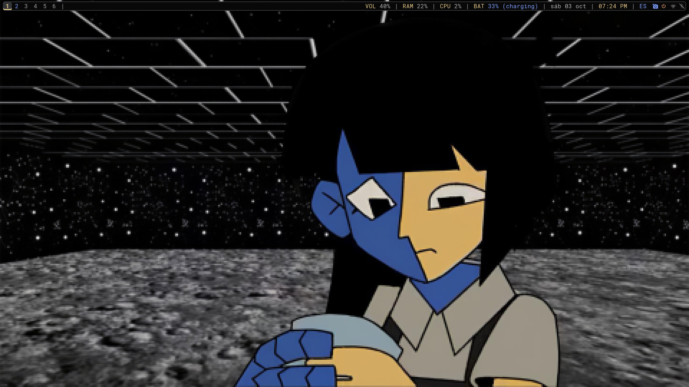
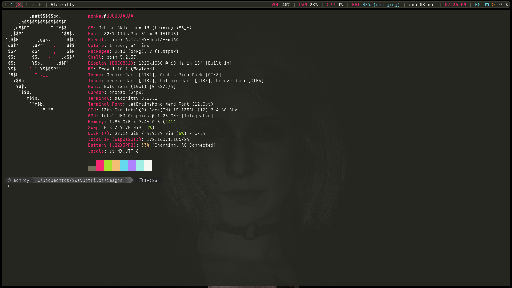
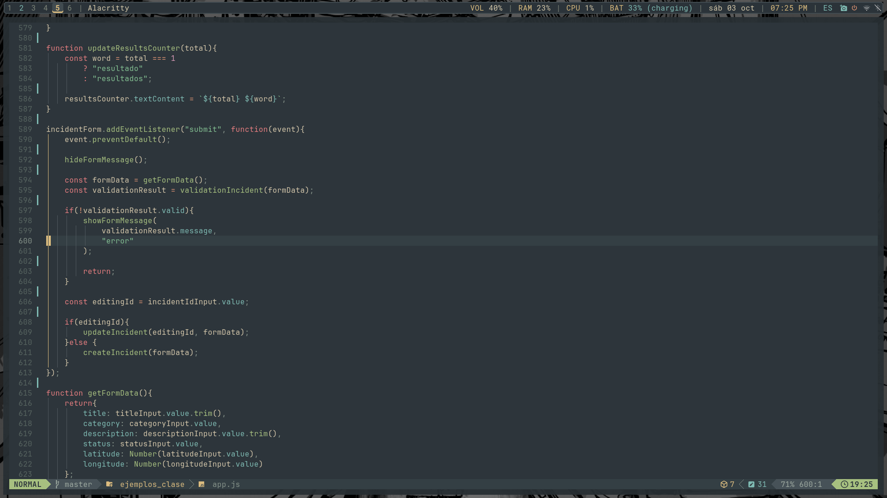

# Sway Dotfiles

<p align="center">
  
</p>

Mis archivos personales de **Sway (Wayland)** con **Waybar**, **wofi**, **alacritty**,
**dunst**, **Starship** y **Neovim (LazyVim)**.

## Screenshots







---

## Autor original

Adaptación a Sway del setup de i3 de **justaguylinux**
(<https://codeberg.org/justaguylinux/i3-setup>). Las **Nerd Fonts** y los
**temas GTK/iconos** (Orchis/Colloid) se instalan con los scripts de
**butterscripts** del mismo autor.

---

## Paquetes

```bash
sudo apt update && sudo apt upgrade -y

sudo apt install -y \
  sway swaybg swayidle swaylock \
  waybar wofi alacritty \
  brightnessctl grim slurp wl-clipboard cliphist jq wtype \
  dbus dbus-user-session polkitd lxpolkit \
  dunst libnotify-bin pavucontrol pamixer pipewire-audio pulseaudio-utils \
  network-manager-gnome blueman \
  thunar thunar-archive-plugin thunar-volman gvfs-backends gvfs-fuse \
  papirus-icon-theme fonts-recommended fonts-font-awesome \
  xwayland \
  firefox-esr geany gimp gsimplecal playerctl \
  starship pipx \
  curl wget git
```

### Alacritty como terminal por defecto

```bash
sudo update-alternatives --install /usr/bin/x-terminal-emulator x-terminal-emulator /usr/bin/alacritty 60
sudo update-alternatives --set x-terminal-emulator /usr/bin/alacritty
```

### Fuentes Nerd Fonts y temas GTK/iconos

```bash
# Nerd Fonts -> ~/.local/share/fonts
curl -fsSL https://codeberg.org/justaguylinux/butterscripts/raw/branch/main/theming/install_nerdfonts.sh -o /tmp/install_nerdfonts.sh
bash /tmp/install_nerdfonts.sh

# GTK Orchis + iconos Colloid -> ~/.themes y ~/.local/share/icons
# (también crea ~/.config/gtk-3.0/settings.ini, que usa el thememenu)
curl -fsSL https://codeberg.org/justaguylinux/butterscripts/raw/branch/main/theming/install_theme.sh -o /tmp/install_theme.sh
bash /tmp/install_theme.sh

fc-cache -f
```

---

## Instalación

Copia el contenido a `~/.config`:

```bash
cp -rT sway       ~/.config/sway
cp -rT waybar     ~/.config/waybar
cp -rT wofi       ~/.config/wofi
cp -rT alacritty  ~/.config/alacritty
cp -rT nvim       ~/.config/nvim
cp starship.toml  ~/.config/starship.toml
cp rofimoji.rc    ~/.config/rofimoji.rc

# Unidades systemd de la sesión (Waybar ligado a sway-session.target)
cp -rT sway/systemd/user ~/.config/systemd/user
systemctl --user daemon-reload
systemctl --user mask waybar.service
systemctl --user enable sway-waybar.service

chmod +x ~/.config/sway/scripts/*
mkdir -p ~/Screenshots
```

### Starship

Añade al final de `~/.bashrc`:

```bash
command -v starship >/dev/null && eval "$(starship init bash)"
```

### Neovim

Instala Neovim desde los **releases oficiales**
(<https://github.com/neovim/neovim/releases>), ya que la versión de apt está
desactualizada y LazyVim no funciona con ella. La configuración es un starter
de **LazyVim**; al abrir `nvim` por primera vez instalará los plugins
automáticamente.

### Emoji picker (rofimoji)

```bash
sudo apt install pipx
pipx install rofimoji
pipx ensurepath
```

### Inactividad

Los tiempos de bloqueo y apagado se ajustan en `~/.config/sway/idle.conf`:
`LOCK_TIMEOUT` (bloqueo), `DPMS_TIMEOUT` (apagado), `MEDIA_GRACE` y
`POLL_INTERVAL` (detección de audio) e `INHIBIT_FULLSCREEN` (ventanas a
pantalla completa). La pantalla no se bloquea ni se apaga mientras haya audio
reproduciéndose.

### Layouts del teclado

Los layouts (`es`, `latam`, `us`) vienen del paquete **`xkb-data`** (en Debian
va por defecto):

```bash
sudo apt install xkb-data
localectl list-x11-keymap-layouts | grep -E 'us|latam|es'
```

Se definen en `sway/config`:

```
input * xkb_layout "es,latam,us"
```

El layout activo se cicla con `Super + Space` o pulsando la etiqueta
**ES/LAT/US** de Waybar (`custom/language`, que ejecuta `scripts/keylayout` y
`swaymsg input '*' xkb_switch_layout next`). Para usar otros layouts, cambia la
lista de `xkb_layout`, por ejemplo `"us,es"`.

---

## Keybindings

| Atajo | Acción |
|-------|--------|
| `Super + d` | Lanzador |
| `Super + Return` | alacritty |
| `Super + Shift + Return` | scratchpad |
| `Super + v` | Historial de portapapeles |
| `Super + .` | Selector de emoji (rofimoji) |
| `Super + /` | Ayuda de atajos |
| `Super + h/j/k/l` | Foco |
| `Super + Shift + h/j/k/l` | Mover ventana |
| `Super + ctrl + h/j/k/l` | Redimensionar |
| `Alt + Tab` / `Alt + Shift + Tab` | Enfocar siguiente / anterior |
| `Super + Shift + m` | Alternar ventana flotante |
| `Super + Shift + f` | Alternar pantalla completa |
| `Super` + clic izquierdo (arrastrar) | Mover ventana flotante |
| `Super` + clic derecho (arrastrar) | Redimensionar ventana flotante |
| `Super + w` | Layout tabbed |
| `Super + t` | Ciclar layout (split → tabbed → stacking) |
| `Super + q` | Cerrar ventana |
| `Super + 1..6` | Workspaces 1..6 |
| `Super + Shift + 1..6` | Mover a workspace |
| `Super + Space` | Cambiar layout de teclado (ES → LAT → US) |
| `Super + s` / `Super + Shift + s` | Captura completa / región |
| `Super + Shift + t` | Cambiar tema |
| `Super + x` / `Super + Shift + x` | Apagar/Reiniciar / Bloquear y pausar |
| `Super + Shift + r` | Recargar la configuración |
| `Super + Shift + q` | Salir de sway |

---

## Temas

Cada carpeta en `~/.config/sway/themes/<nombre>/` contiene dos archivos:

- `theme.conf` — nombre visible, tema GTK/iconos, fondo, paleta de `alacritty`
  y colores de `dunst`.
- `colors.css` — paleta única (`@define-color`) que usan Waybar y wofi.

`scripts/thememenu` (o `Super + Shift + T`) expande esa paleta en el bloque
`/* THEME:BEGIN */`…`/* THEME:END */` de `waybar/style.css` y
`wofi/style.css`, **genera** `colors.conf` (bordes de sway) a partir de la
paleta y del `dunst_highlight_normal`, copia `alacritty/current-theme.toml`,
ajusta GTK con `gsettings` + `settings.ini`, reescribe `wallpaper.conf` (el
fondo lo aplica sway con `output * bg`), reescribe los colores de `dunst` y
recarga sway/Waybar. El tema activo se guarda en `~/.cache/sway/current_theme`.

Los 11 temas incluidos son: catppuccin, doomone, dracula, everforest, github_dark,
gruvbox, kanagawa, monokai, moonfly, nord, rose_pine.
